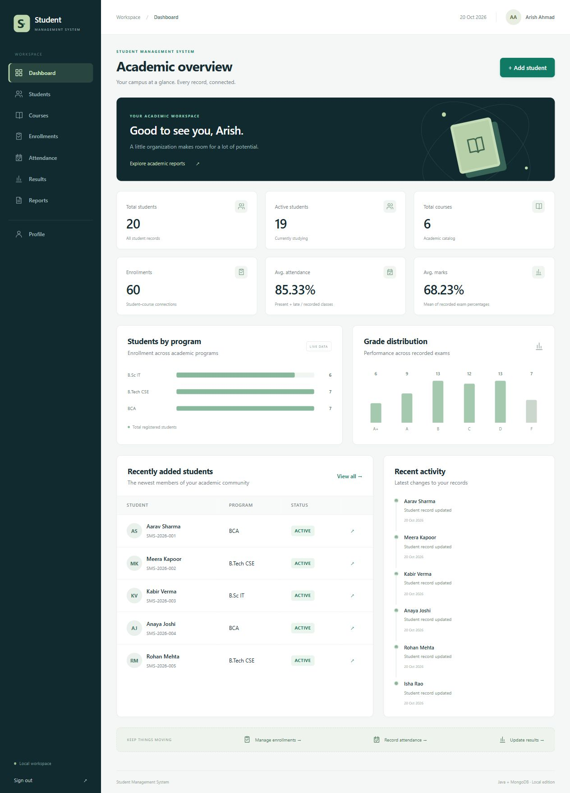

# Student Management System

A Java-based full-stack web application for managing student records and academic progress. Built with **Java Servlets, MongoDB, HTML, CSS, and vanilla JavaScript**, with the important business rules implemented in Java.



## Run in VS Code — Windows

1. Extract the project ZIP. Open the **student-management-system** folder in VS Code (the folder containing `pom.xml`). Do not use Live Server: the Java server serves both the UI and API.
2. Install **JDK 17 or newer** and **MongoDB Community Server** if needed. Java 21 LTS is a suitable choice. Maven is downloaded automatically when a source build is needed.
3. Start MongoDB. If you installed it as a Windows service, it may already be running. Otherwise, open a VS Code terminal and run:

```powershell
powershell -ExecutionPolicy Bypass -File .\start-mongodb.ps1
```

4. Keep that terminal open. In a **second terminal**, run:

```powershell
.\run.bat
```

5. Open **http://localhost:8080**.

| Demo sign-in | Value |
| --- | --- |
| Email | `admin@studentmanagement.local` |
| Password | `Admin@123` |

These public credentials are only for a local demonstration. The database stores a salted BCrypt hash, not the password. The explicit `--seed` demo initializer and login demo helper intentionally contain these public example credentials; no production credentials are included.

The supplied ZIP includes a tested runnable JAR in `release/`. `run.bat` prefers your own `target/` build if present, otherwise uses that JAR. A clone without the release JAR automatically builds from source. Source edits require a rebuild:

```powershell
.\run.bat -Rebuild
```

Press **Ctrl+C** in the app terminal to stop Jetty, then in the MongoDB terminal if you started it manually. Do not stop a MongoDB service used by another project.

### Build and test from source

```powershell
.\mvnw.cmd clean package
java -jar target\student-management-system.jar --seed
```

Or, with Maven installed:

```powershell
mvn clean package
java -jar target\student-management-system.jar --seed
```

Maven needs internet access the first time it downloads dependencies. The Windows bootstrap downloads Apache Maven 3.9.11 from Maven Central and verifies its SHA-512 checksum. An installed `mvn.cmd` is reused when available. The application has no CDN/font/network dependency after building; it only needs its MongoDB connection.

### Installing MongoDB

Use the [official MongoDB Community Windows instructions](https://www.mongodb.com/docs/v8.0/tutorial/install-mongodb-on-windows/) and choose **MongoDB Community Server**, not just Compass. The installer can configure a Windows service. Compass is an optional viewer and does not replace the server. The included helper also finds the usual `C:\Program Files\MongoDB\Server\<version>\bin\mongod.exe` installation and starts it with project-local storage in `.data/mongodb`.

If the helper reports that port 27017 is in use, the existing MongoDB service may already be running; proceed with the app instead of launching another database on the same port. See the [official Windows service guide](https://www.mongodb.com/docs/manual/administration/run-mongodb-windows/).

### Configuration

| Environment variable | Default | Purpose |
| --- | --- | --- |
| `MONGODB_URI` | `mongodb://127.0.0.1:27017` | Connection string |
| `MONGODB_DATABASE` | `student_management_system` | Database name |
| `PORT` | `8080` | Local web port |
| `SEED_DEMO` | unset | Set to `true` to enable demo seeding |

For example, in the terminal used to start the application:

```powershell
$env:MONGODB_URI = 'mongodb://127.0.0.1:27017'
$env:MONGODB_DATABASE = 'student_management_system'
$env:PORT = '8080'
.\run.bat
```

`run.bat` enables demo seeding. This adds missing demo records, preserves existing records, and avoids duplicates through stable natural keys and unique indexes. It recreates deliberately deleted seed records when seeding is requested again. To preserve demo deletions on subsequent runs, use:

```powershell
.\run.bat -NoSeed
```

The first run must seed to create the demo administrator. A fresh database started without seeding has no administrator. The application reads real process environment variables; it does not automatically load `.env` files. `MONGODB_URI` can later point to another MongoDB deployment without source changes, but no cloud resources or deployment are configured here.

## Features

- Administrator login/logout, BCrypt password hashing, 30-minute sessions, protected routes and CSRF protection.
- Student CRUD with personal/academic details, case-insensitive search, program/semester/status filters, sorting, and server-side pagination.
- Student profiles showing enrolled courses, attendance totals and per-course summaries, and results.
- Course CRUD, course search, status/semester filters, and enrolled-student views.
- Student–course enrollment with duplicate and active-status checks.
- Attendance CRUD with student, course, date and status filters.
- Results CRUD with Java-calculated percentages and grades; search and student/course/grade filters.
- Dashboard statistics, program and grade charts, recent student records and recent update activity.
- Academic reports, admissions/semester charts, and CSV export with spreadsheet-formula protection.
- Responsive sidebar, dialogs, validation messages, confirmation before deletion, and toast feedback.
- Consistent 403/404/500 page designs and JSON API errors.
- Optional fictional demo data: 20 students, 6 courses, 60 enrollments, 300 attendance records, and 60 results.

## Technology stack

| Layer | Technology |
| --- | --- |
| Language | Java 17 source compatibility; verified with JDK 25 |
| HTTP/server | Jakarta Servlets 6, embedded Jetty 12.0.36 |
| Persistence | MongoDB Community; official synchronous Java Driver 5.5.1 |
| UI | HTML5, CSS3, vanilla JavaScript, inline SVG/CSS charts |
| JSON/passwords | Gson 2.13.1, jBCrypt 0.4 |
| Build/tests | Maven 3.9.11, JUnit Jupiter 5.12.2 |
| Repository | Git/GitHub-ready source, README and MIT license |

No Spring, ORM, frontend framework, Node server, or SQL database is used. Jetty supplies servlet/session infrastructure; your Java classes implement validation and application rules. See [Jetty's documentation](https://jetty.org/docs/jetty/12.1/index.html) and the [official MongoDB Java Driver documentation](https://www.mongodb.com/docs/drivers/java/sync/current/).

## Architecture

```text
Browser: HTML / CSS / JavaScript
                |
         AuthFilter (session + CSRF)
                |
         Module Servlet (HTTP / JSON)
                |
       Service (validation + business rules)
                |
       Repository (MongoDB operations)
                |
      Shared MongoClient -> MongoDB
```

All authoritative application rules live in Java: authentication, validation, relationships, duplicate handling, attendance percentages, grades, reports, search, pagination, and database access. JavaScript sends requests and renders results. Native HTML form constraints improve usability but never replace server validation. Immutable model records provide encapsulated fields, constructors, and accessors. `CrudService<T>` and `MongoRepository<T>` share repeated mechanics; subclasses add module-specific rules.

## Project structure

```text
student-management-system/
  pom.xml                    Maven dependencies and executable JAR build
  run.bat / run.ps1          Easy Windows launcher
  mvnw.cmd / .mvn/           Maven bootstrap with checksum verification
  start-mongodb.ps1          Optional local MongoDB launcher
  .vscode/tasks.json         Run, database and build tasks
  release/                  Ready-to-run JAR in the download ZIP (Git-ignored)
  src/main/java/com/studentmanagement/
    Application.java        Embedded Jetty wiring
    model/                  Student, Course, Enrollment, Attendance, Result, User
    servlet/                HTTP request/response handling
    service/                Rules, CRUD, authentication and analytics
    repository/             MongoDB queries and unique indexes
    database/               Shared connection and explicit demo seeder
    validation/             Server-side input validation
    filter/                 Authentication, CSRF and response headers
    exception/              Safe status/message exception
    util/                   JSON and BCrypt utilities
  src/main/resources/       Logging configuration
  src/main/webapp/           HTML, CSS, JS and error pages
  src/test/java/             JUnit tests
  scripts/smoke-test.py      Optional HTTP integration test, Python standard library
  docs/                     Architecture, interview guide, verification, screenshots
```

## Rules and MongoDB design

Collections: `users`, `students`, `courses`, `enrollments`, `attendance`, `results`. Each has a stable string UUID `id` plus MongoDB's internal `_id`. Student/course references keep course edits consistent without copying academic history into unbounded student documents. There are no SQL foreign keys: services check references and restrict deletion.

Unique indexes cover user email, enrollment number, course code, student/course enrollment, student/course/date attendance, and student/course/exam/date results. All records also have a unique application `id`. Additional indexes cover student filters and common course/attendance lookups. See [architecture details](docs/ARCHITECTURE.md).

- **Attendance:** `(PRESENT + LATE) / all recorded classes × 100`. Excellent ≥90%, Good ≥75%, Warning below 75%. No records displays a separate “No attendance yet” label. Unmarked classes do not count as absent.
- **Marks:** `obtained / maximum × 100`. A+ ≥90, A ≥80, B ≥70, C ≥60, D ≥50, F below 50. Grade uses the unrounded percentage; the display rounds to two decimals.
- **Averages:** dashboard attendance is across all attendance records. Average marks is an unweighted mean of exam percentages, not GPA or a credit-weighted CGPA.
- **Deletion:** remove attendance/results before their enrollment, then remove the student/course. No silent cascade deletion.
- **Concurrency:** one application-wide write lock protects check-then-write relationship operations in this single-process local app; MongoDB unique indexes enforce uniqueness at storage level.

## Testing

```powershell
.\mvnw.cmd test
```

30 JUnit tests cover grade boundaries, attendance thresholds, no-data cases, impossible counts, student fields, date parsing, marks validation, and BCrypt behavior. The build report is in [docs/VERIFICATION.md](docs/VERIFICATION.md).

Optional, with the seeded app running and Python 3 installed:

```powershell
python scripts/smoke-test.py http://127.0.0.1:8080
```

This test makes 65 HTTP checks plus assertions, creates uniquely named disposable records, verifies validation/security/CRUD, and deletes its records. Run it only against a local demo database. The standard application does not need Python.

## Screenshots

- [Dashboard](docs/screenshots/dashboard.jpg)
- [Student list](docs/screenshots/students.jpg)
- [Student profile](docs/screenshots/student-profile.jpg)
- [Courses](docs/screenshots/courses.jpg)
- [Attendance](docs/screenshots/attendance.jpg)
- [Results](docs/screenshots/results.jpg)
- [Mobile dashboard](docs/screenshots/mobile-dashboard.jpg)

## Troubleshooting

| Symptom | Action |
| --- | --- |
| Cannot connect to MongoDB | Start the MongoDB service or helper; confirm URI/port. The server intentionally fails before serving an unusable app. |
| `java` not found / class version error | Install JDK 17+, reopen VS Code, and set `JAVA_HOME` to its installation folder. |
| Maven cannot download | Check network access/proxy. Retry the build. The bundled release JAR does not require Maven downloads. |
| Port 8080 is in use | Stop the other local server or set `$env:PORT = '8081'` and open that port. |
| Login rejects the demo account | Run once with `--seed` (default `run.bat` behavior) against the intended database. |
| Edited source does not appear | Stop the app, run `.\run.bat -Rebuild`, then refresh the browser. |
| Delete returns a conflict | Remove dependent attendance/results, then enrollment, then the student/course. |
| Session expired | Sign in again. Sessions are intentionally lost on server restart. |

## Known scope and future improvements

This is a local, single-administrator portfolio application. Account profile is read-only; no password reset, registration, teacher/student roles, file uploads, bulk attendance, term history, audit log, or deployment is included. Recent activity derives from current record timestamps and is not an immutable audit trail.

Tables paginate on the server. Related-record selectors fetch the student/course catalog in pages for this small demo. Analytics and reports collect data in Java for clarity. For a large institution, replace those selectors with typeahead queries, use MongoDB aggregation for reports, and use transactions with a replica set plus a distributed concurrency strategy before running multiple app instances. Regex search is escaped but not intended as a large-scale full-text search engine.

Future work could include role-based access, semester/term modeling, import/export improvements, password management, and an optional Spring Boot migration after learning the fundamentals. These are not implemented features.

## Author

**Arish Ahmad** · [GitHub](https://github.com/arish-9211) · [LinkedIn](https://linkedin.com/in/arishahmad9211)

See [the project report and interview guide](docs/PROJECT-REPORT.md) for resume bullets, important classes, and an end-to-end Add Student walkthrough.
